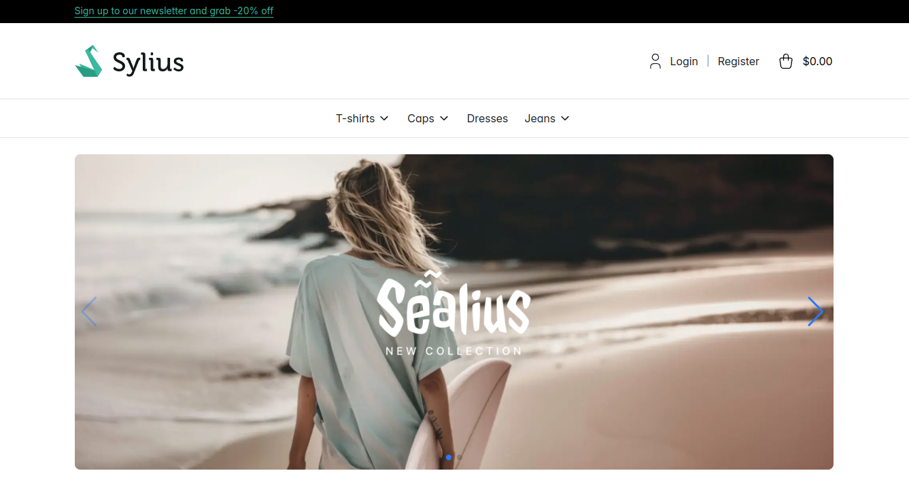
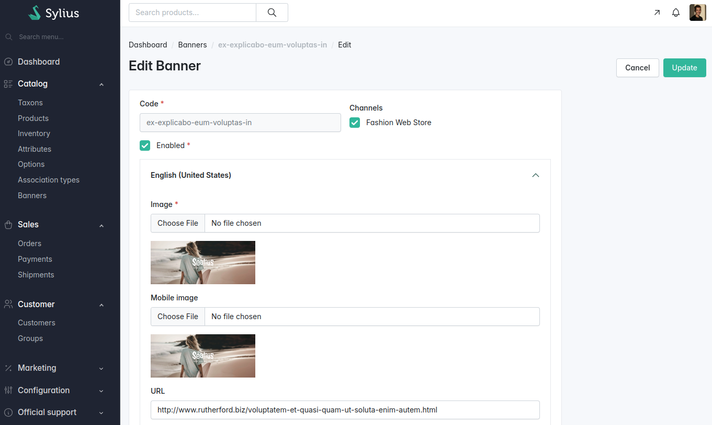

<p align="center">
    <a href="https://odiseo.io/en/products/sylius-plugins?utm_source=github&utm_medium=readme&utm_campaign=sylius-banner-plugin" target="_blank">
        
    </a>
</p>
<p align="center">
    <a href="https://packagist.org/packages/odiseoteam/sylius-banner-plugin"></a>
    <a href="https://packagist.org/packages/odiseoteam/sylius-banner-plugin"></a>
    <a href="https://github.com/odiseoteam/SyliusBannerPlugin/actions/workflows/build.yml"></a>
    
    
    <a href="LICENSE"></a>
</p>

## Introduction

This plugin adds banners to your Sylius store. Each banner has its own image, copy and link, and is fully customizable from the admin.

### What makes this plugin different?

- ✅ **Translatable banners** - Each locale has its own image, texts, button and link
- ✅ **A separate mobile image** - Upload a second image and it replaces the main one on small screens
- ✅ **Per channel** - Enable each banner on the channels you want
- ✅ **Homepage or taxons** - A banner goes on the homepage, or on the product list of the taxons you assign it to
- ✅ **Slider included** - A single banner renders as an image, several as a [Swiper.js](https://github.com/nolimits4web/swiper) slider
- ✅ **Optimized images** - Rendered through LiipImagine as WebP by default, with configurable quality
- ✅ **Sortable** - A `position` field, editable from the admin, sets the order
- ✅ **API included** - Manage the banners and read them from a headless storefront through the Sylius API

<details open>
<summary>
 Screenshots
</summary> <br />

<p align="center">
    
</p>

<table>
    <tr>
        <td width="50%" align="center">
            
            <br /><sub><b>Admin:</b> A Banners section under Catalog</sub>
        </td>
        <td width="50%" align="center">
            
            <br /><sub><b>Editing:</b> Image, mobile image, copy and link per locale</sub>
        </td>
    </tr>
</table>

</details>

## Getting Started

### Install it in 6 steps ⚡

1. ✅ Require the plugin
2. ✅ Add Swiper
3. ✅ Import and build the assets
4. ✅ Import the plugin configuration
5. ✅ Add the shop and admin routes
6. ✅ Run the migrations

**[👉 Follow the installation guide](doc/installation.md)**

### Quick Example

Require the plugin and the slider it uses:

```bash
composer require odiseoteam/sylius-banner-plugin
yarn add swiper@^11.2.7
```

Once the remaining steps are done, a new **Banners** section shows up under **Catalog** in the admin panel, and the banner is rendered on the homepage.

## Configuration

### Images

The banner images are rendered through LiipImagine. By default the plugin serves them as WebP, with quality 80 for the desktop filter set and 75 for the mobile one. You can change it from your application:

```yml
# config/packages/odiseo_sylius_banner.yaml
odiseo_sylius_banner:
    images:
        format: webp # null keeps the format of the uploaded file
        quality: 80
        mobile_quality: 75
```

> [!NOTE]
> **Upgrading from 2.0**: previously no format or quality was declared, so the images were served in their original format with quality 100. Set `format: null` and `quality: 100` to keep the old behaviour. The uploaded file is always stored as it is, only the rendered image changes.

### Storage

The uploaded images are stored through Flysystem, in `public/media/banner-image` by default. To store them somewhere else, override the storage from your application:

```yml
# config/packages/flysystem.yaml
flysystem:
    storages:
        odiseo_banner.storage.banner_image:
            adapter: 'local'
            options:
                directory: '%sylius_core.public_dir%/media/banner-image'
            directory_visibility: 'public'
```

### Homepage or taxons

A banner without taxons is shown on the homepage. A banner assigned to one or more taxons is shown only on the product list of those taxons, above the products. A taxon without banners of its own shows the ones of its closest parent that has any. Both are set from the **Visibility** card of the banner form, and the admin list shows where each banner appears and can be filtered by taxon.

To render the banners of a taxon somewhere else, use the component with a `taxon`:

```twig
{{ component('odiseo_banner:shop:banners', {taxon: taxon}) }}
```

### Order

Banners have a `position` field. They are rendered from the lowest position to the highest one, using the id as a tie-breaker, and the position is editable from the admin panel. The admin grid is sorted by position as well.

## API

The plugin exposes the banners through the Sylius API, on the API Platform version your Sylius release ships.

### Admin

Everything the admin panel does, with the administrator token of the Sylius API.

| Method | Path | What it does |
| ------ | ---- | ------------ |
| GET | `/api/v2/admin/banners` | Lists the banners by position. Filters: `code`, `enabled`, `taxons.code`. Sorting: `order[code]`, `order[position]`, `order[createdAt]` |
| POST | `/api/v2/admin/banners` | Creates a banner, images included (`multipart/form-data`) |
| GET | `/api/v2/admin/banners/{code}` | Shows a banner with its translations |
| PUT | `/api/v2/admin/banners/{code}` | Updates the position, state, channels, taxons and texts (JSON) |
| POST | `/api/v2/admin/banners/{code}/images` | Replaces the images of a translation (`multipart/form-data`) |
| DELETE | `/api/v2/admin/banners/{code}` | Deletes a banner |

A banner needs an image, so it is created in a single multipart request:

```bash
curl -X POST https://example.com/api/v2/admin/banners \
    -H "Authorization: Bearer $TOKEN" \
    -F "code=summer_sale" \
    -F "position=1" \
    -F "channels[]=/api/v2/admin/channels/WEB" \
    -F "translations[en_US][mainText]=Summer sale" \
    -F "translations[en_US][url]=https://example.com/sale" \
    -F "translations[en_US][image]=@banner.png" \
    -F "translations[en_US][mobileImage]=@banner-mobile.png"
```

The texts of each translation are `url`, `mainText`, `secondaryText` and `buttonText`. Updating sends only what changes, and the translations that are not sent stay as they are:

```bash
curl -X PUT https://example.com/api/v2/admin/banners/summer_sale \
    -H "Authorization: Bearer $TOKEN" -H "Content-Type: application/json" \
    -d '{"enabled": false, "translations": {"en_US": {"mainText": "Winter sale"}}}'
```

To replace an image, or to add the image of a new locale, send the `locale` with an `image`, a `mobileImage` or both:

```bash
curl -X POST https://example.com/api/v2/admin/banners/summer_sale/images \
    -H "Authorization: Bearer $TOKEN" \
    -F "locale=en_US" -F "image=@banner.png"
```

### Shop

Public and read only: the enabled banners of the channel being browsed, in their order and translated to the requested locale.

| Method | Path | What it does |
| ------ | ---- | ------------ |
| GET | `/api/v2/shop/banners` | Lists the banners. Filters: `taxons.code` for the ones of a taxon, `exists[taxons]=false` for the ones of the homepage |
| GET | `/api/v2/shop/banners/{code}` | Shows a banner |

Each banner comes with `url`, `mainText`, `secondaryText`, `buttonText` and the URLs of the rendered images, `image` and `mobileImage`.

## Documentation

- 📦 **[Installation](doc/installation.md)** - Six steps, from Composer to the migrations
- 📝 **[Changelog](CHANGELOG.md)** - What changed in each release

## Compatibility

| Package       | Version             |
| ------------- | ------------------- |
| PHP           | ^8.2                |
| sylius/sylius | ^2.0 (2.0 to 2.3)   |
| Database      | MySQL or PostgreSQL |

## Development

The plugin runs on the shared [Sylius Test Application](https://github.com/Sylius/TestApplication), with Docker:

```bash
make init            # dependencies, assets and containers
make database-init   # database and migrations
make load-fixtures
```

The quality suite is the one CI runs:

```bash
make phpunit
make behat
make phpstan
make ecs
make composer-unused
```

## Professional Support

This plugin is maintained by [Odiseo](https://odiseo.io/en?utm_source=github&utm_medium=readme&utm_campaign=sylius-banner-plugin). Need help with it, or with any Sylius project?

- 🎬 **[Live demo](https://odiseo.io/en/contact-us?utm_source=github&utm_medium=readme&utm_campaign=sylius-banner-plugin)** - A live walkthrough of this plugin
- 🛠️ **[Sylius development](https://odiseo.io/en/contact-us?utm_source=github&utm_medium=readme&utm_campaign=sylius-banner-plugin)** - Help with this plugin or any Sylius project
- 🔌 **[More Sylius plugins](https://odiseo.io/en/products/sylius-plugins?utm_source=github&utm_medium=readme&utm_campaign=sylius-banner-plugin)** - Browse all our Sylius plugins

## License

[MIT](LICENSE).
