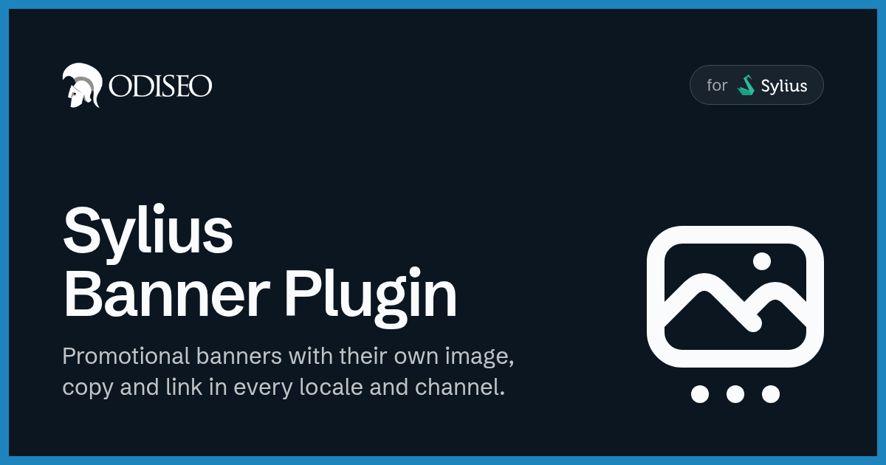
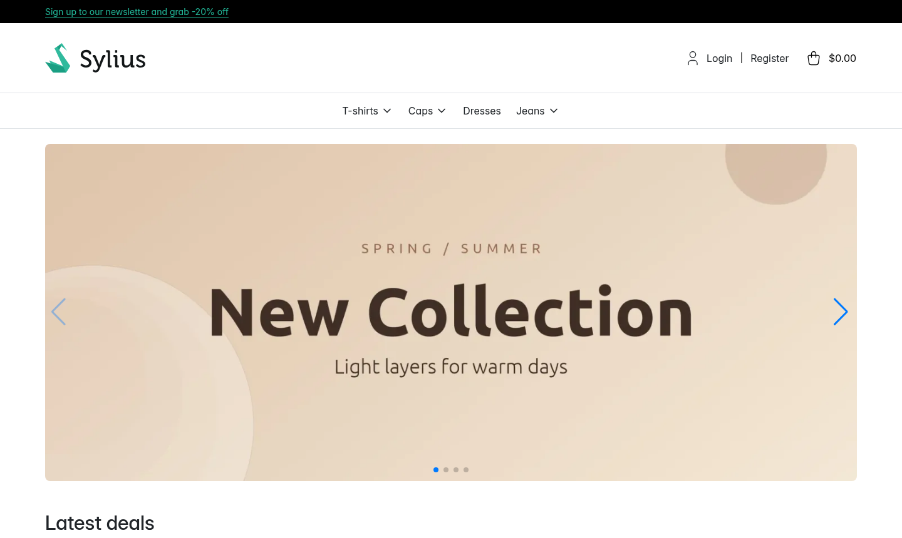
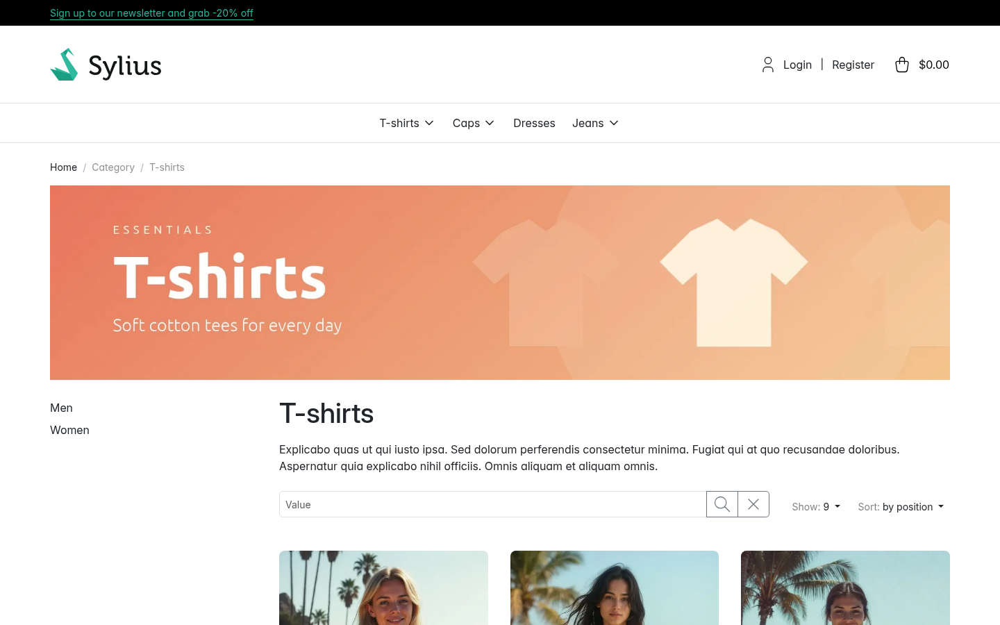
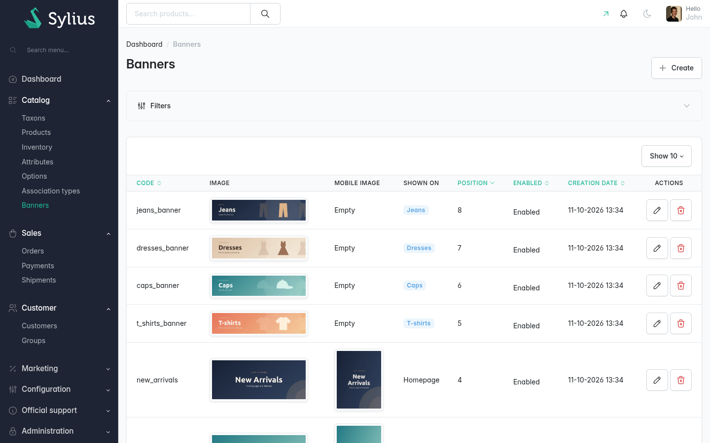
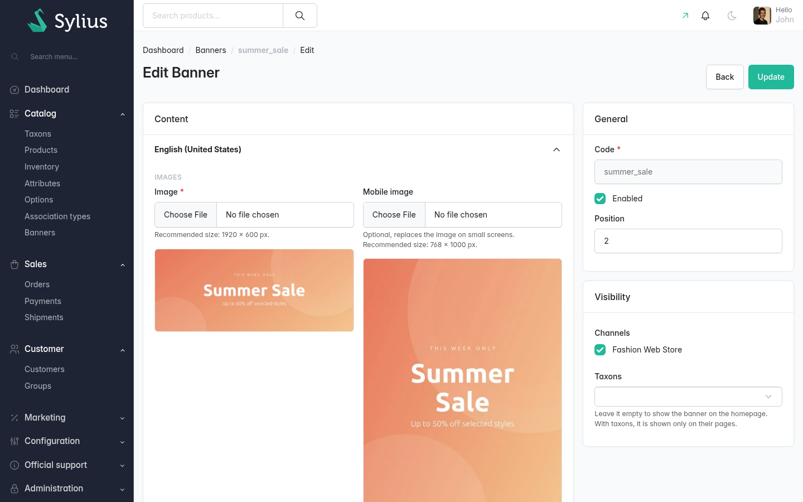

<p align="center">
    <a href="https://odiseo.io/en/products/sylius-plugins?utm_source=github&utm_medium=readme&utm_campaign=sylius-banner-plugin" target="_blank">
        
    </a>
</p>
<p align="center">
    <a href="https://packagist.org/packages/odiseoteam/sylius-banner-plugin"></a>
    <a href="https://packagist.org/packages/odiseoteam/sylius-banner-plugin"></a>
    <a href="https://github.com/odiseoteam/SyliusBannerPlugin/actions/workflows/build.yaml"></a>
    
    
    <a href="LICENSE"></a>
</p>

## Introduction

This plugin adds banners to your Sylius store. Each banner has its own image, copy and link, and is fully customizable from the admin.

### What makes this plugin different?

- ✅ **Translatable banners** - Each locale has its own image, texts, button and link
- ✅ **A separate mobile image** - Upload a second image and it replaces the main one on small screens
- ✅ **Per channel** - Enable each banner on the channels you want
- ✅ **Homepage or taxons** - A banner goes on the homepage, or on the product list of the taxons you assign it to
- ✅ **Slider included** - A single banner renders as an image, several as a [Swiper.js](https://github.com/nolimits4web/swiper) slider
- ✅ **Optimized images** - Rendered through LiipImagine as WebP by default, with configurable quality
- ✅ **Sortable** - A `position` field, editable from the admin, sets the order
- ✅ **API included** - Manage the banners and read them from a headless storefront through the Sylius API

<details open>
<summary>
 Screenshots
</summary> <br />

<p align="center">
    
</p>

<table>
    <tr>
        <td width="50%" align="center">
            
            <br /><sub><b>Taxons:</b> A banner above the products of each taxon</sub>
        </td>
        <td width="50%" align="center">
            
            <br /><sub><b>Admin:</b> A Banners section under Catalog</sub>
        </td>
    </tr>
</table>

<p align="center">
    
    <br /><sub><b>Editing:</b> Images, texts and link per locale, with the visibility on the side</sub>
</p>

</details>

## Getting Started

### Install it in 6 steps ⚡

1. ✅ Require the plugin
2. ✅ Add Swiper
3. ✅ Import and build the assets
4. ✅ Import the plugin configuration
5. ✅ Add the shop and admin routes
6. ✅ Run the migrations

**[👉 Follow the installation guide](doc/installation.md)**

### Quick Example

Require the plugin and the slider it uses:

```bash
composer require odiseoteam/sylius-banner-plugin
yarn add swiper@^11.2.7
```

Once the remaining steps are done, a new **Banners** section shows up under **Catalog** in the admin panel, and the banner is rendered on the homepage.

## How it works

A banner without taxons is shown on the homepage. A banner assigned to taxons is shown only on the product list of those taxons, and a taxon without banners of its own shows the ones of its closest parent.

| Banner         | Shown on                                             |
| -------------- | ---------------------------------------------------- |
| Without taxons | The homepage                                         |
| With taxons    | The product list of those taxons, above the products |

One banner is rendered as an image, several as a slider, ordered by position.

**[Learn more about displaying banners →](doc/displaying-banners.md)**

## Documentation

- 📦 **[Installation](doc/installation.md)** - Six steps, from Composer to the migrations
- 🖼️ **[Managing banners](doc/managing-banners.md)** - The list and the form of the admin panel
- 🏠 **[Displaying banners](doc/displaying-banners.md)** - Homepage, taxons, components and templates
- ⚙️ **[Configuration](doc/configuration.md)** - Image format and quality, storage and fixtures
- 🔌 **[API](doc/api.md)** - The admin and shop endpoints
- 🧩 **[Extending](doc/extending.md)** - The hooks of the admin form, the entities and the services
- 🛠️ **[Development](doc/development.md)** - Test application, test suites and the CI matrix
- 📝 **[Changelog](CHANGELOG.md)** - What changed in each release, with the upgrade notes

## Compatibility

| Sylius                | PHP             | Symfony   | Database           |
| --------------------- | --------------- | --------- | ------------------ |
| 2.0 · 2.1 · 2.2 · 2.3 | 8.2 · 8.3 · 8.4 | 6.4 · 7.4 | MySQL · PostgreSQL |

Sylius 2.3 needs PHP 8.3 or later.

## Professional Support

This plugin is maintained by [Odiseo](https://odiseo.io/en?utm_source=github&utm_medium=readme&utm_campaign=sylius-banner-plugin). Need help with it, or with any Sylius project?

- 🎬 **[Live demo](https://odiseo.io/en/contact-us?utm_source=github&utm_medium=readme&utm_campaign=sylius-banner-plugin)** - A live walkthrough of this plugin
- 🛠️ **[Sylius development](https://odiseo.io/en/contact-us?utm_source=github&utm_medium=readme&utm_campaign=sylius-banner-plugin)** - Help with this plugin or any Sylius project
- 🔌 **[More Sylius plugins](https://odiseo.io/en/products/sylius-plugins?utm_source=github&utm_medium=readme&utm_campaign=sylius-banner-plugin)** - Browse all our Sylius plugins

## License

[MIT](LICENSE).
