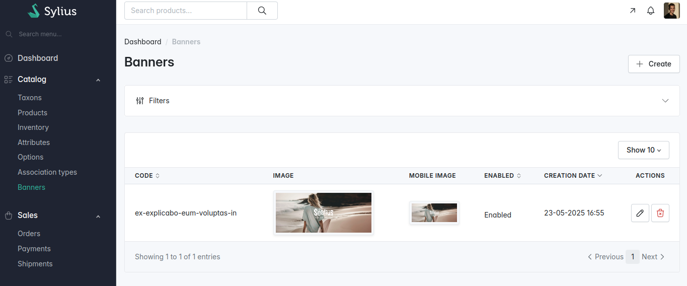

<p align="center">
    <a href="https://odiseo.io/en/products/sylius-plugins?utm_source=github&utm_medium=readme&utm_campaign=sylius-banner-plugin" target="_blank">
        
    </a>
</p>
<p align="center">
    <a href="https://packagist.org/packages/odiseoteam/sylius-banner-plugin"></a>
    <a href="https://packagist.org/packages/odiseoteam/sylius-banner-plugin"></a>
    <a href="https://github.com/odiseoteam/SyliusBannerPlugin/actions/workflows/build.yml"></a>
    
    
    <a href="LICENSE"></a>
</p>

## Introduction

This plugin adds banners to your Sylius store. Each banner has its own image, copy and link, and is fully customizable from the admin.

### What makes this plugin different?

- ✅ **Translatable banners** - Each locale has its own image, texts, button and link
- ✅ **A separate mobile image** - Upload a second image and it replaces the main one on small screens
- ✅ **Per channel** - Enable each banner on the channels you want
- ✅ **By taxon or everywhere** - Show all the banners, or only the ones assigned to a taxon
- ✅ **Slider included** - A single banner renders as an image, several as a [Swiper.js](https://github.com/nolimits4web/swiper) slider
- ✅ **Optimized images** - Rendered through LiipImagine as WebP by default, with configurable quality
- ✅ **Sortable** - A `position` field, editable from the admin, sets the order

<details open>
<summary>
 Screenshots
</summary> <br />

<p align="center">
    
</p>

<table>
    <tr>
        <td width="50%" align="center">
            
            <br /><sub><b>Admin:</b> A Banners section under Catalog</sub>
        </td>
        <td width="50%" align="center">
            
            <br /><sub><b>Editing:</b> Image, mobile image, copy and link per locale</sub>
        </td>
    </tr>
</table>

</details>

## Getting Started

### Install it in 6 steps ⚡

1. ✅ Require the plugin
2. ✅ Add Swiper
3. ✅ Build the assets
4. ✅ Import the plugin configuration
5. ✅ Add the shop and admin routes
6. ✅ Run the migrations

**[👉 Follow the installation guide](doc/installation.md)**

### Quick Example

Require the plugin and the slider it uses:

```bash
composer require odiseoteam/sylius-banner-plugin
yarn add swiper@^11.2.7
```

Once the remaining steps are done, a new **Banners** section shows up under **Catalog** in the admin panel, and the banner is rendered on the homepage.

## Configuration

### Images

The banner images are rendered through LiipImagine. By default the plugin serves them as WebP, with quality 80 for the desktop filter set and 75 for the mobile one. You can change it from your application:

```yml
# config/packages/odiseo_sylius_banner.yaml
odiseo_sylius_banner:
    images:
        format: webp # null keeps the format of the uploaded file
        quality: 80
        mobile_quality: 75
```

> [!NOTE]
> **Upgrading from 2.0**: previously no format or quality was declared, so the images were served in their original format with quality 100. Set `format: null` and `quality: 100` to keep the old behaviour. The uploaded file is always stored as it is, only the rendered image changes.

### Order

Banners have a `position` field. They are rendered from the lowest position to the highest one, using the id as a tie-breaker, and the position is editable from the admin panel. The admin grid is sorted by position as well.

## Documentation

- 📦 **[Installation](doc/installation.md)** - Six steps, from Composer to the migrations
- 📝 **[Changelog](CHANGELOG.md)** - What changed in each release

## Compatibility

| Package       | Version |
| ------------- | ------- |
| PHP           | ^8.2    |
| sylius/sylius | ^2.0    |

## Professional Support

This plugin is maintained by [Odiseo](https://odiseo.io/en?utm_source=github&utm_medium=readme&utm_campaign=sylius-banner-plugin). Need help with it, or with any Sylius project?

- 🎬 **[Live demo](https://odiseo.io/en/contact-us?utm_source=github&utm_medium=readme&utm_campaign=sylius-banner-plugin)** - A live walkthrough of this plugin
- 🛠️ **[Sylius development](https://odiseo.io/en/contact-us?utm_source=github&utm_medium=readme&utm_campaign=sylius-banner-plugin)** - Help with this plugin or any Sylius project
- 🔌 **[More Sylius plugins](https://odiseo.io/en/products/sylius-plugins?utm_source=github&utm_medium=readme&utm_campaign=sylius-banner-plugin)** - Browse all our Sylius plugins

## License

[MIT](LICENSE).
